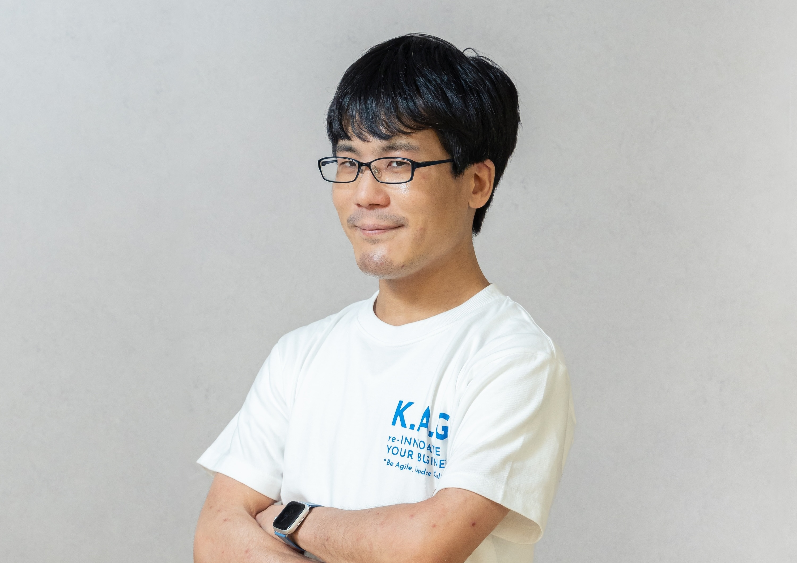
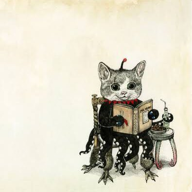
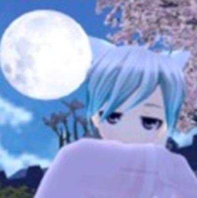
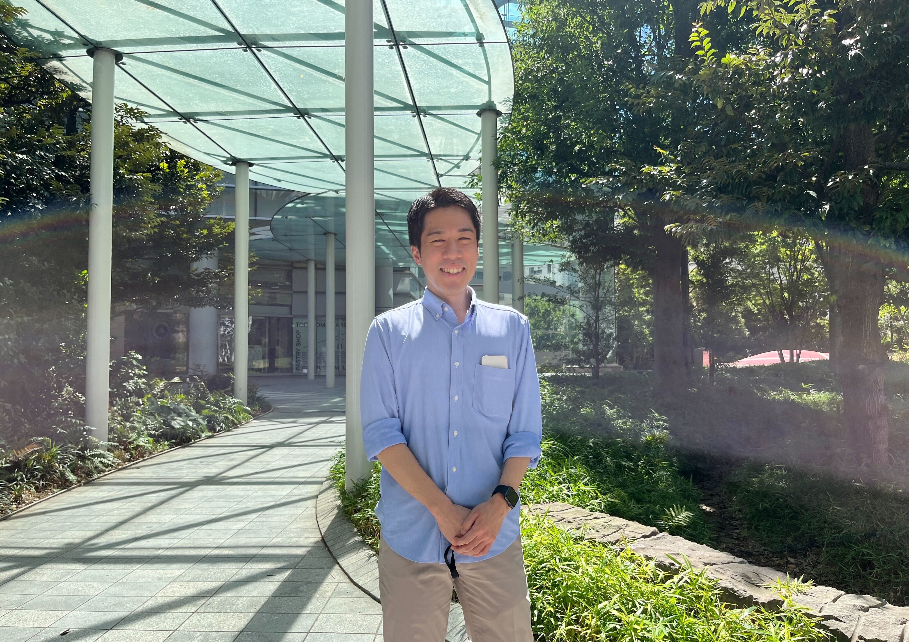
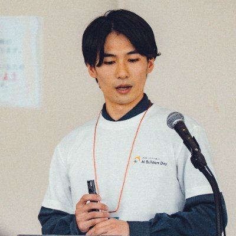
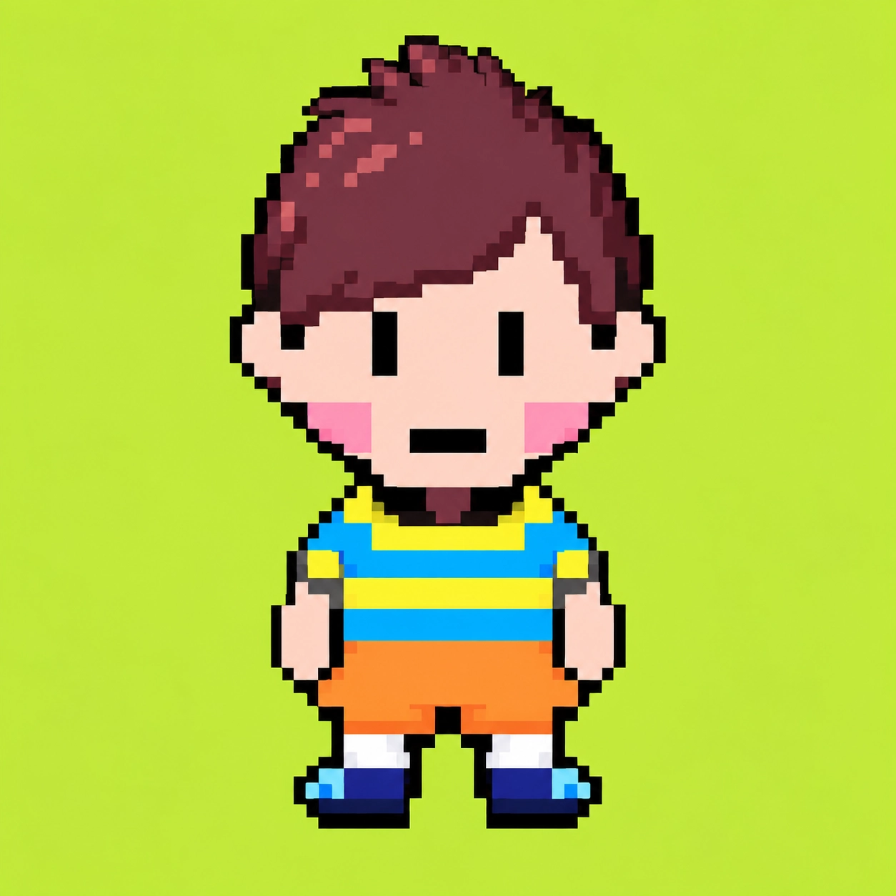

東京支部運営メンバー紹介connpass用テンプレ
---

```md
# 運営メンバー紹介

### みのるん [@minorun365](https://twitter.com/minorun365) （KDDIアジャイル開発センター株式会社）



> クラウドやAI分野を中心に、技術の楽しさを伝える活動をしています。<br>AWS AI Hero, AWS Samurai, 2025 Japan AWS Top Engineer & All Certs, Qiita 2024 Top Contributor / 著書「Amazon Bedrock 生成AIアプリ開発入門」,「やさしいMCP入門」,「AIエージェント開発運用入門」


### watany [@_watany](https://twitter.com/_watany) (NTTテクノクロス株式会社)



> 2015年からAWSを用いた開発に携わり、アーキテクト・運用設計支援として活動する一方で、社内にてテクニカルサポートや研修講師を務めています。また、AWS Community BuilderとしてAWS CDKのContributeや技術ブログの執筆を行っています。2024 AWS Ambassadorを受賞。


### y-ohgi [@_y_ohgi](https://twitter.com/_y_ohgi) (株式会社Topotal)



> 株式会社TopotalでSREをやっております。

### ムリギッテ [@momitanJP](https://twitter.com/momitanJP)



> パブリックセクターから金融機関、製造業まで様々な業界のお客様に向けたシステム提案・導入をしています。最近はCDK、コンテナ、データ基盤がメイン。趣味はBlackbeltを聞きながら筋トレです。

### ふくち [@har1101mony](https://x.com/har1101mony)



>LLMを触って遊んだり、LLMを組み込んだシステムの開発をしています。AWS Community Builder(AI Engineering) / 2025 Japan AWS Jr.Champion

### くらっち [@kuracchi_enj](https://x.com/kuracchi_enj)


>普段はRuby on Railsを用いたWebアプリケーション開発をメイン業務としています。好きなAWSサービスは、Bedrock AgentCoreです。私が何者なのかわからなくなってきている今日この頃...

### ますの


> 社内SEや運用保守系のインフラエンジニアからスタート。最近はアーキテクトの設計構築やPM的な役割が多めです。ネットワークやセキュリティ、監査関連など。  
> 2026 AWS Ambassadorに就任。JAWS-UG配信部で各支部のオンライン配信もお手伝い中。


# 参加のルール/マナー
勉強会に参加される方は、JAWS-UGの定める以下のルール/マナーに則って行動することをお願いしております。

## ルール
- 関係者の人種、性別、性的指向、身体的特徴、見た目、政治、宗教（または無宗教）などに係る表現は、いかなる場合も適切ではありません。  
- JAWS-UG は No sell, No Job です。イベントの趣旨と関係のない宣伝行為・採用活動・ネットワーキングのみを目的としたご参加はご遠慮ください。  

ルールに違反する方は参加をお断りする場合がございます。

## マナー
- あなたのクリエイティブで前向きな発言がイベントをより楽しくします。発表者や質問者に対して疑問や意見がある場合は批判や罵り・嘲りではなく提案と課題解決の態度でポジティブな発言を心がけましょう。  
- 全てのイベントは有志のボランティアにより非営利目的にて運営され、いつでもあなたの手助けを必要としています。お気付きの点があればぜひご協力をお願いいたします。  
- 私たちはコミュニティへの貢献を通じて社会からの信頼を得ることがより良いビジネスに繋がり、より自分らしい働き方を見つける手段になると信じています。  
- AWSのユーザーグループは日本中、世界中に存在し、あなたの参加を待っています。是非コミュニティを通じて世界中の仲間と繋がりましょう。  

https://jaws-ug.jp/for-participant/
```

<details><summary>👇 preview</summary>

# 運営メンバー紹介

### みのるん [@minorun365](https://twitter.com/minorun365) （KDDIアジャイル開発センター株式会社）


> クラウドやAI分野を中心に、技術の楽しさを伝える活動をしています。<br>AWS AI Hero, AWS Samurai, 2025 Japan AWS Top Engineer & All Certs, Qiita 2024 Top Contributor / 著書「Amazon Bedrock 生成AIアプリ開発入門」,「やさしいMCP入門」,「AIエージェント開発運用入門」


### watany [@_watany](https://twitter.com/_watany) (NTTテクノクロス株式会社)


> 2015年からAWSを用いた開発に携わり、アーキテクト・運用設計支援として活動する一方で、社内にてテクニカルサポートや研修講師を務めています。また、AWS Community BuilderとしてAWS CDKのContributeや技術ブログの執筆を行っています。2024 AWS Ambassadorを受賞。


### y-ohgi [@_y_ohgi](https://twitter.com/_y_ohgi) (株式会社Topotal)


> 株式会社TopotalでSREをやっております。

### ムリギッテ [@momitanJP](https://twitter.com/momitanJP)


> パブリックセクターから金融機関、製造業まで様々な業界のお客様に向けたシステム提案・導入をしています。最近はCDK、コンテナ、データ基盤がメイン。趣味はBlackbeltを聞きながら筋トレです。

### ふくち [@har1101mony](https://x.com/har1101mony)


>LLMを触って遊んだり、LLMを組み込んだシステムの開発をしています。AWS Community Builder(AI Engineering) / 2025 Japan AWS Jr.Champion

### くらっち [@kuracchi_enj](https://x.com/kuracchi_enj)


>普段はRuby on Railsを用いたWebアプリケーション開発をメイン業務としています。好きなAWSサービスは、Bedrock AgentCoreです。私が何者なのかわからなくなってきている今日この頃...

### ますの


> 社内SEや運用保守系のインフラエンジニアからスタート。最近はアーキテクトの設計構築やPM的な役割が多めです。ネットワークやセキュリティ、監査関連など。  
> 2026 AWS Ambassadorに就任。JAWS-UG配信部で各支部のオンライン配信もお手伝い中。


# 参加のルール/マナー
勉強会に参加される方は、JAWS-UGの定める以下のルール/マナーに則って行動することをお願いしております。

## ルール
- 関係者の人種、性別、性的指向、身体的特徴、見た目、政治、宗教（または無宗教）などに係る表現は、いかなる場合も適切ではありません。  
- JAWS-UG は No sell, No Job です。イベントの趣旨と関係のない宣伝行為・採用活動・ネットワーキングのみを目的としたご参加はご遠慮ください。  

ルールに違反する方は参加をお断りする場合がございます。

## マナー
- あなたのクリエイティブで前向きな発言がイベントをより楽しくします。発表者や質問者に対して疑問や意見がある場合は批判や罵り・嘲りではなく提案と課題解決の態度でポジティブな発言を心がけましょう。  
- 全てのイベントは有志のボランティアにより非営利目的にて運営され、いつでもあなたの手助けを必要としています。お気付きの点があればぜひご協力をお願いいたします。  
- 私たちはコミュニティへの貢献を通じて社会からの信頼を得ることがより良いビジネスに繋がり、より自分らしい働き方を見つける手段になると信じています。  
- AWSのユーザーグループは日本中、世界中に存在し、あなたの参加を待っています。是非コミュニティを通じて世界中の仲間と繋がりましょう。  

https://jaws-ug.jp/for-participant/

</details>

